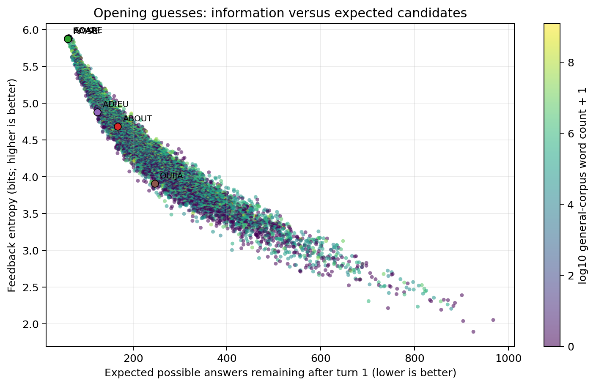
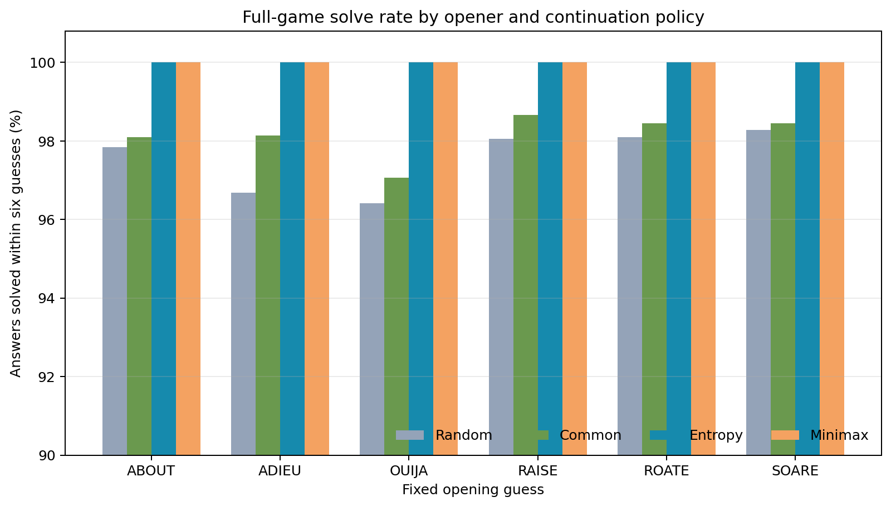
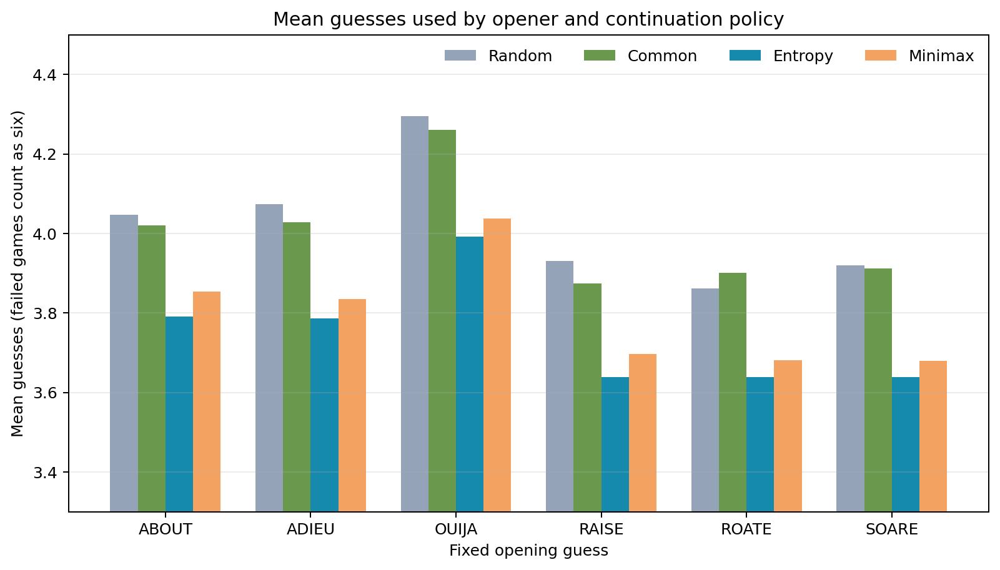

# Wordle Probability and Strategy Benchmark

## Abstract

This project uses Wordle to study how probability and information can guide decisions over several turns. I wrote a simulator that tests different opening words and follow-up guessing strategies against a fixed list of 2,315 possible answers. For each answer, it simulates games with six openers and four continuation strategies, producing 55,560 games in total.

The main result is that the two feedback-based policies, entropy and minimax, solved every answer in this benchmark. The entropy policy used the fewest guesses on average: 3.638 with ROATE as the opener. The simpler common-word and random policies were less reliable. These results apply to the fixed answer list and assumptions used here; they do not guarantee performance on future Wordle puzzles or model real human play.

## 1. Motivation and research question

I started this project because Wordle is a simple game with a useful probability problem underneath it. A guess can either try to name the answer directly or gather information that makes later guesses easier. The colored feedback after each guess changes what I know about the hidden word, so the best decision can change from turn to turn.

I wanted to understand what it means for a guess to be “informative,” whether an opener chosen for information performs differently from a familiar vowel-heavy opener, and how different ways of using feedback affect the number of guesses needed.

The main question was:

> When every possible answer is tested under the same rules, how do different opening words and follow-up decision strategies affect the probability of solving Wordle within six guesses and the average number of guesses used?

I included **ADIEU** and **OUIJA** as familiar, vowel-heavy baselines. They are compared with words selected using information-related measures and general word frequency.

## 2. Data and simulation setup

The answer list contained **2,315 five-letter words**. The legal-guess list combined those answers with additional allowed guesses, for **12,972 legal guesses** in total. The answer is selected uniformly from the fixed answer list: each word is treated as equally likely.

For each answer, the simulator tested six fixed opening words:

| Opening word | Why it was included |
|---|---|
| ABOUT | Highest-ranked common word in the general English corpus used here |
| ADIEU | Familiar vowel-heavy baseline |
| OUIJA | Familiar vowel-heavy baseline |
| RAISE | High-ranked under opening information measures |
| ROATE | High-ranked under opening information measures |
| SOARE | Highest entropy opener in this answer-list benchmark |

Each opener was paired with four follow-up strategies. With 2,315 answers, six openers, and four strategies, the benchmark played **2,315 × 6 × 4 = 55,560 games**. In this report, one **game** (or episode) means one complete simulated puzzle for one hidden answer, one fixed opener, and one continuation strategy.

### How feedback is simulated

After a guess, the simulator compares each letter with the hidden answer and produces the Wordle feedback pattern:

- **Green:** the letter is correct and in the correct position.
- **Yellow:** the letter appears in the answer but in a different position.
- **Grey:** the letter does not appear in the answer, after accounting for any matching copies.

Repeated letters require special handling. The simulator marks green matches first, then assigns yellow matches only to copies of letters that remain unmatched in the answer. It then removes every answer that would not produce exactly the observed feedback. The strategy chooses the next guess from the updated information, and play ends when the answer is guessed or six guesses have been used.

## 3. The four strategies

All four methods receive the same feedback and begin with the same fixed opener for a given comparison. They differ in how they choose guesses after the opener.

### 3.1 Random remaining answer

The random strategy chooses one word uniformly at random from the answers still consistent with the feedback. It does not try a separate “probe” word to distinguish candidates; each guess must itself be one of the remaining possible answers.

This is a simple baseline. It answers the question: how well might a solver do if it keeps guessing plausible answers but does not deliberately optimize the information from a guess? A fixed random seed makes the simulated random choices reproducible.

### 3.2 Common-word remaining answer

The common-word strategy also chooses only from the remaining possible answers. Among those candidates, it chooses the word with the highest count in a general English word-frequency corpus. If two candidates have equal counts, it uses alphabetical order to break the tie.

This strategy is meant as a limited proxy for preferring a word that looks familiar. It is **not** a direct model of a person playing Wordle: it still has the complete answer list and filters that list exactly using feedback. The corpus counts describe general web-text frequency, not Wordle answer probability.

### 3.3 Maximum information / entropy

The entropy strategy looks at all legal guesses, including words that cannot be the answer, and asks how much each guess is expected to teach it. A word’s feedback divides the remaining candidates into groups. For example, all answers that produce the same green-yellow-grey pattern belong to the same group.

Suppose there are $$N$$ remaining candidates. If a guess can produce feedback pattern $$j$$ for $$n_j$$ candidates, then the probability of that pattern under the equal-probability assumption is:

$$
p_j = \frac{n_j}{N}.
$$

The entropy of the guess is:

$$
H = -\sum_j p_j \log_2(p_j).
$$

In plain language, entropy is high when a guess is expected to split the possible answers into many reasonably balanced groups. The feedback is then more useful because it is less likely to leave one very large group of possibilities. The strategy chooses the legal guess with the greatest entropy for the next feedback step. If guesses tie, the code uses expected remaining candidates and whether the word is itself a remaining answer as tie-breakers.

Entropy is measured in **bits**. It can be thought of as the uncertainty removed, on average, by observing the feedback, given the benchmark’s assumptions. A guess that happens to match the answer immediately is useful, but the entropy calculation also values guesses that distinguish many other possibilities when they are wrong.

### 3.4 Minimax

Minimax also considers all legal guesses and their feedback groups, but it focuses on the **worst possible group** rather than the average information. For each guess, the simulator finds the largest number of candidates that could remain after any feedback pattern. Minimax chooses the guess with the smallest such largest group. If there is a tie, it uses the average expected remaining candidates as a tie-breaker.

For example, imagine eight candidates. A guess that splits them into groups of four and four has a largest group of four. A guess that splits them into groups of seven and one has a largest group of seven. Minimax prefers the first guess because even its least helpful outcome leaves fewer candidates.

This is a cautious rule: it tries to control the worst case. Entropy, by contrast, cares about the overall distribution of feedback outcomes. Their choices can differ because a strategy can have a good average split while still leaving one unusually large group, or can control its largest group while not achieving the best average information.

## 4. How openers were selected

The opening analysis scored every legal guess against the full answer list, assuming each answer was equally likely. It recorded:

1. **Feedback entropy:** higher is better because outcomes are more informative on average.
2. **Expected candidates remaining:** lower is better. If feedback group sizes are $$n_j$$, this is $$\sum_j (n_j/N)n_j = \sum_j n_j^2/N$$. It is the expected size of the candidate group left after the guess.
3. **Worst-case group size:** lower is better because it limits how many candidates can remain after the least helpful feedback.
4. **General word frequency:** higher is used as a proxy for familiarity, not for probability of being a Wordle answer.

The benchmark retained the top three openers under each ranking and included ADIEU and OUIJA as baselines. The overlap among rankings resulted in six distinct openers. Those six were then held fixed while all 2,315 answers and all four continuation strategies were evaluated.



**Figure 1. Opening-word information trade-off.** Each point is a legal opener. The horizontal axis is the expected number of candidates left after its feedback, and the vertical axis is feedback entropy. The highlighted examples show that information value and general word frequency are different properties. SOARE had 5.886 bits of entropy and 62.30 expected candidates remaining; ROATE had 5.883 bits and 60.42 expected candidates remaining. ABOUT was much more common in the corpus, but had 4.685 bits and 167.02 expected remaining candidates. The plot does not assign probabilities to future Wordle answers.

## 5. Results

### Full-game solve rates

| Opener | Random | Common word | Entropy | Minimax |
|---|---:|---:|---:|---:|
| ABOUT | 97.84% | 98.10% | 100.00% | 100.00% |
| ADIEU | 96.67% | 98.14% | 100.00% | 100.00% |
| OUIJA | 96.41% | 97.06% | 100.00% | 100.00% |
| RAISE | 98.06% | **98.66%** | 100.00% | 100.00% |
| ROATE | 98.10% | 98.44% | 100.00% | 100.00% |
| SOARE | **98.27%** | 98.44% | 100.00% | 100.00% |



**Figure 2. Solve rate by opener and continuation strategy.** Entropy and minimax solved all 2,315 answers for every opener. The random and common-word rules failed on some answers because they do not choose probe guesses that split a difficult candidate set. The vertical axis is zoomed to 90–100% to make the smaller differences among those baselines visible; it does not start at zero.

### Average guesses

Mean guesses includes every game. A failed game contributes six guesses, so this metric reflects both efficiency and failures. The table shows the mean for every tested opener-policy pair.

| Opener | Random | Common word | Entropy | Minimax |
|---|---:|---:|---:|---:|
| ABOUT | 4.048 | 4.021 | 3.790 | 3.854 |
| ADIEU | 4.073 | 4.028 | 3.786 | 3.834 |
| OUIJA | 4.296 | 4.261 | 3.993 | 4.038 |
| RAISE | 3.930 | 3.873 | 3.639 | 3.696 |
| ROATE | 3.861 | 3.902 | **3.638** | 3.682 |
| SOARE | 3.919 | 3.912 | 3.638 | **3.679** |



**Figure 3. Mean guesses by opener and continuation strategy.** Entropy has the lowest mean guesses for each opener. The best entropy pairing was ROATE at 3.638 guesses per answer. The best minimax mean was SOARE at 3.679. The differences are small because both strategies solved every answer, but they optimize different criteria: average information and worst-case group size.

### A closer comparison of key cases

- **Entropy versus minimax:** Both solved all answers on this list. Entropy was slightly more efficient by average guesses for each opener. Minimax’s goal is to limit the largest remaining group, which may be useful even when it does not minimize average guesses.
- **Common word versus information-rich opener:** ABOUT is the most frequent opener in the corpus, but SOARE and ROATE produce more informative first-turn feedback under the uniform-answer model. With entropy follow-ups, the opener differences become relatively small because the strategy can use later feedback effectively.
- **ADIEU versus OUIJA:** With entropy continuation, ADIEU averaged 3.786 guesses and OUIJA 3.993. Testing vowels alone is not enough to determine opener quality; the pattern of letters across all possible answers matters.
- **Random versus common:** The common-word method was usually better than random in this benchmark, but it still failed on some answers because it does not use non-answer probe words.

## 6. Interpretation

The experiment suggests that the way a solver uses feedback matters more than selecting an opener solely because it contains many vowels or is a common word. The entropy and minimax strategies both used the entire legal guess dictionary to choose informative follow-up guesses. This allowed them to resolve difficult candidate groups that the random and common-word policies could not reliably handle within six turns.

The opener still has an effect. OUIJA was the weakest of the tested openers for the entropy and minimax strategies in average guesses, while RAISE, ROATE, and SOARE performed closely. The very small differences among the top openers should not be over-interpreted: the solver’s follow-up policy and the fixed answer list both influence the results.

The “common word” results should be interpreted especially carefully. The strategy does not behave like a person who has to remember words unaided. It is still given the complete possible-answer list, and after every guess it can eliminate answers exactly. Its only human-style feature is choosing the remaining answer with the largest count in a general English corpus. It is a comparison policy, not a validated model of human decision-making.

## 7. Limitations

1. **Uniform answer probability.** Every listed answer is treated as equally likely. Actual Wordle answer selection may not follow this distribution.
2. **Fixed answer list.** The conclusions apply to the 2,315-word list used here. A different list, or a future set of answers, could change opener rankings and solve rates.
3. **In-sample opener selection.** The same answer list was used to rank openers and evaluate the selected finalists. This can favor words that fit this particular list. A stronger generalization study would select openers on one answer set and evaluate them on a separate held-out set.
4. **Corpus-frequency proxy.** The five-letter counts come from Peter Norvig’s `count_1w.txt`, derived from the Google Web Trillion Word Corpus. They measure general web-text frequency, not Wordle answer frequency or how people actually guess. Source: [Norvig’s corpus files](https://www.norvig.com/ngrams/).
5. **Greedy decision rules.** Entropy and minimax choose the best next guess according to a one-step score. They do not search every possible full decision tree for a globally optimal six-turn strategy.
6. **Dictionary access.** All strategies receive exact feedback and a word list. The common-word policy still has access to the candidate list, so the results do not compare a human with no dictionary against a computer solver.
7. **Random seed.** The random baseline uses seed `20304000` so the run is reproducible. A different seed can slightly change its results.

## 8. Conclusion

This project models Wordle as a sequence of decisions under uncertainty. Each guess partitions the remaining answers into feedback groups, and each strategy uses those groups differently. Random guessing and choosing the most frequent remaining word are simple baselines. Entropy tries to maximize average information, while minimax tries to limit the worst possible remaining group.

On the fixed answer set, the feedback-based policies solved every answer in six guesses. Entropy used slightly fewer guesses on average, with ROATE as the best tested opener by that measure. The project’s main finding is not that one word is universally best, but that an opener’s value depends on how later feedback is used. The result also shows why a probability-based strategy can outperform a guess that merely seems familiar or vowel-rich.

## Reproducing the analysis

The simulator is in [`wordle.py`](../wordle.py). Inputs are in the project’s `data/` directory. The run used random seed `20304000`; its game-by-game output and aggregate results are saved in [`games.csv`](games.csv) and [`benchmark_summary.csv`](benchmark_summary.csv). The opening scores are in [`opening_scores.csv`](opening_scores.csv). Run the full analysis from the project directory with:

```powershell
python wordle.py
```

This report and all three images are in the same `results/` directory, so the relative image links above render when the project directory is uploaded to GitHub.
